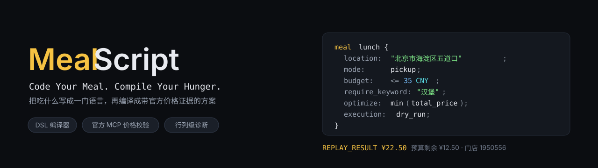
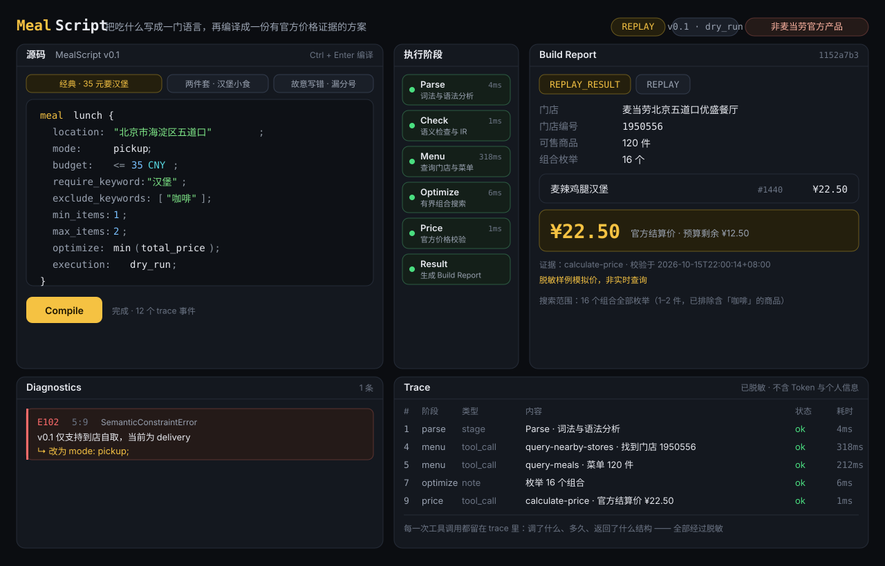

<p align="left">
  
  
  
  
</p>

### 立刻试试

- **在线 Demo**：https://konggu2077.github.io/MealScript-/dist/mealscript.html —— 不用装任何东西，打开即用，断网也能跑
  （仓库设置里开启 Pages：`Settings → Pages → Deploy from a branch → main / (root)` 后生效）
- **下载单文件网页**：[`dist/mealscript.html`](dist/mealscript.html)（265 KB，双击即开，CSS/JS 全内联、零外部请求）

### 目录

- [界面一览](#界面一览)
- [这不是一个聊天点餐助手](#这不是一个聊天点餐助手)
- [快速开始](#快速开始)
- [目录结构](#目录结构)
- [DSL v0.1 语法](#dsl-v01-语法)
- [真实性规则（我们的红线）](#真实性规则我们的红线)
- [Live 与 Replay 的区别](#live-与-replay-的区别)
- [测试](#测试)
- [与官方标准的偏差说明（如实记录）](#与官方标准的偏差说明如实记录)
- [免责声明](#免责声明)

> Code Your Meal. Compile Your Hunger.

**MealScript 是一门面向真实麦当劳点餐场景的轻量 DSL，配一个真正自己写的编译器。**
**自己写的编译器 · 官方 MCP 真实结算价 · 行列级可解释诊断**

你用可编译的约束语句描述预算与偏好，系统用麦当劳官方 MCP 查询真实门店、真实菜单与真实结算价，产出带调用证据的候选方案，以及能精确到行列的编译诊断。

```
meal lunch {
  location: "北京市海淀区五道口";
  mode: pickup;
  budget: <= 35 CNY;
  require_keyword: "汉堡";
  exclude_keywords: ["咖啡"];
  min_items: 1;
  max_items: 2;
  optimize: min(total_price);
  execution: dry_run;
}
```

→ 编译结果：

```
REPLAY_RESULT  官方结算价 ¥22.50  预算剩余 ¥12.50
  麦辣鸡腿汉堡 (1440) × 1   ¥22.50
  门店：麦当劳北京五道口优盛餐厅 (1950556)
```

---

## 界面一览



左边写 `.meal`，中间六个阶段依次亮起，右边给出带官方结算价的结果卡，底部是脱敏后的执行轨迹。
状态由真实事件驱动，不是动画；`Live` / `Replay` 标签全程可见。

故意写错一行，它不会含糊地说「我不太确定」，而是给出行列号、错误码和修复建议：

```
E102  5: 9  SemanticConstraintError — v0.1 仅支持到店自取，当前为 delivery
    ↳ 改为 mode: pickup;
```

---

## 这不是一个聊天点餐助手

市面上大多数参赛作品是「把需求丢给大模型，让它编一份方案」。MealScript 不一样：

| | 普通 AI 点餐助手 | MealScript |
|---|---|---|
| 需求处理 | 提示词转发给大模型 | **自己写的词法/语法分析 → AST → 语义检查 → IR** |
| 价格来源 | 模型猜测或静态抄录 | **官方 `calculate-price` 真实返回** |
| 出错时 | 「抱歉，我搞错了」 | **`E101 6:11 预算必须为正数 ↳ 把预算改成正数`** |
| 数据真假 | 说不清 | **Live / Replay 标签全程可见，永不混用** |

**编译器是手写代码，不是提示词工程。** 这就是为什么它能给出行列级诊断。

---

## 快速开始

```bash
# 环境：Node.js >= 20（本项目在 Node v22.22.2 上开发）
npm install

# 1) 不依赖任何凭据，先验证编译器是真的
npm run compile:cli examples/budget.meal

# 2) 跑全部测试（115 个）
npm test

# 3) 启动网页 Playground
npm run dev          # → http://localhost:3000
```

打开页面后有 5 个内置示例，其中 3 个是**故意写错的**——用来看结构化错误长什么样。

### 单文件离线版（双击即开，无需安装任何东西）

```bash
npm run build:single   # → dist/mealscript.html（约 265 KB）
```

`dist/mealscript.html` 是一个**自包含的单文件网页**：CSS 与 JS 全部内联，**零外部请求、零凭据、离线可用**。
编译器、语义检查、组合搜索、价格校验全部在浏览器里真实运行；门店与价格来自一次真实会话的**脱敏录制样例**，
所以它的状态恒为 `REPLAY_RESULT`，永远不会伪装成 `BUILD_PASSED`。

编辑器带**自动补全**：输入字段名、枚举取值（`pickup` / `dry_run` …）时有候选弹窗；
在 `require_keyword` / `exclude_keywords` 的引号里输入时，会从菜单数据里实时联想**分类、商品、标签**
（如 `小食`、`麦旋风`、`爆款`），↑↓ 选择、Tab/Enter 确认、Esc 关闭。
写多关键词时只按**最后一个分隔符之后的片段**联想，并自动把这一行里已经写过的关键词从候选里去掉。

它已提交进仓库，也可以直接从 GitHub 下载后双击打开。构建时 `@mealscript/mcp-adapter` 被强制解析为
`browser.ts`，因此 `node:fs`、MCP SDK 与任何 Token 都不可能进入产物（有测试守着这条边界）。

### 打开 Live 模式（真实 MCP）

```bash
cp .env.example .env
# 在 .env 里填入你的 MCD_MCP_TOKEN（https://open.mcd.cn/mcp 获取）
npm run dev
# 页面上把 Replay 切成 Live
```

`.env` 已在 `.gitignore` 中，Token **不会**进入仓库。没有 Token 也能完整体验 Replay 模式。

### 刷新产品目录与价格（录制新 fixture）

拿到 Token 后，一条命令就能把门店、菜单、分类、标签和官方价全部重新抓一遍：

```bash
cp .env.example .env        # 填 MCD_MCP_TOKEN
npm run fixture:record                                        # 用 .env 里的城市/关键词
npm run fixture:record -- --city=上海市 --keyword=浦东新区陆家嘴
npm run fixture:record -- --store=1950556                     # 指定门店
```

它做的事，以及它**不做**的事：

- 走的就是管线用的那个**只读**适配器 —— 写操作（下单/领券/抽奖）在适配器里被硬阻断，一次都调不到
- 逐件调 `calculate-price` 核对官方价，**只记录「官方价 = 菜单价」的非优惠商品**；有折扣的商品直接跳过，不做猜测
- 递归脱敏：门店地址 / 经纬度 / 距离 / 图片 / traceId / 个人信息全部剔除，并在终端**逐字段打印删了什么**
- 结束时打印与上一版的差异（商品数、新增、下架、价格变动），先 `git diff fixtures/` 复核再提交

`location` 的写法与 `query-nearby-stores` 的对应关系（编译期拆分，见 `packages/compiler/src/location.ts`）：

| `location` 写法 | 拆成 |
|---|---|
| `北京市海淀区五道口` | city=`北京市`，keyword=`海淀区五道口` |
| `上海市浦东新区陆家嘴` | city=`上海市`，keyword=`浦东新区陆家嘴` |
| `深圳市南山区科技园` | city=`深圳市`，keyword=`南山区科技园` |
| `北京 五道口` | city=`北京`，keyword=`五道口` |

编辑器里输入 `location` 的引号时会给出真实地点候选（北京/上海/深圳/广州/成都/杭州共 14 个）；
换地点只影响 Live 查询 —— Replay 的门店来自录制样例，改 `location` 不会换门店，trace 里仍会如实记录你请求的城市与关键词。

---

## 目录结构

```
mealscript/
├── apps/playground/          Next.js 演示界面（Monaco 编辑器 + 阶段流 + Build Report + Trace）
├── apps/single/              单文件离线版的打包入口与 HTML 模板（与 Playground 共用同一套色板）
├── build/single.mjs          单文件构建脚本（esbuild IIFE + 内联 + 泄露扫描）
├── build/record-fixture.ts   从实时 MCP 重新录制 fixture（只读 + 递归脱敏 + 差异报告）
├── dist/mealscript.html      产物：自包含单文件网页（已提交，可直接双击打开）
├── packages/
│   ├── compiler/             Chevrotain 词法/语法分析、AST、语义检查、IR、错误码
│   ├── mcp-adapter/          官方 MCP 客户端、Zod 校验、归一化、Replay Fixture
│   ├── optimizer/            有界组合搜索、去重与排序
│   ├── verifier/             官方价格校验、证据、完整构建流水线
│   └── trace/                统一执行轨迹与脱敏
├── examples/                 三份 .meal 示例（1 份正确 + 2 份故意写错）
├── fixtures/                 脱敏 Replay 案例（成功 / 失败）
├── tests/                    115 个单元与集成测试
├── CONTEST_DECLARATION.md    官方参赛声明原文（未改动一个字）
├── MCP_INTEGRATION.md        实际使用的 MCP Server / Tool / 调用流程
├── mcp-config.example.json   配置示例（只有占位符）
└── workbuddy.md              真实 WorkBuddy 开发记录
```

---

## DSL v0.1 语法

| 字段 | 类型 / 规则 | 违反时的错误码 |
|---|---|---|
| `location` | 字符串，门店发现用的位置文本 | 缺失或空 → E001 |
| `mode` | v0.1 仅 `pickup` | `delivery` → E102 |
| `budget` | `<= 金额 CNY`，金额为正 | `-10` / `USD` → E101 |
| `require_keyword` | 单个关键词，或用 `,` `，` `、` 分隔的多关键词，或字符串数组。按**商品名 / 分类名 / 标签**匹配（如 `汉堡`、`小食`、`甜品`、`咖啡` 都有效） | 空串 → E001；任一关键词无匹配商品 → E211；关键词个数 > `max_items` → E103 |
| `exclude_keywords` | 字符串数组（元素内也可用逗号写多个） | 非法数组 → E001 |
| `min_items` / `max_items` | 整数 1–3 | 越界或 `min > max` → E103 |
| `optimize` | v0.1 仅 `min(total_price)` | `max(protein)` → E104 |
| `execution` | v0.1 固定 `dry_run` | `place_order` → E105 |

**省略时的默认值**：`mode=pickup`、`min_items=1`、`max_items=2`、`optimize=min(total_price)`、`execution=dry_run`。

### 多关键词：AND 语义

`require_keyword` 可以写多个关键词，**每一个都必须命中一件商品**（AND）。三种写法完全等价：

```mealscript
require_keyword: "巨无霸牛鱼肉堡, 麦旋风";      // 一个字符串里逗号分隔
require_keyword: "巨无霸牛鱼肉堡、麦旋风";      // 顿号 / 全角逗号同样识别
require_keyword: ["巨无霸牛鱼肉堡", "麦旋风"];  // 数组
```

去空白、去重后得到 `["巨无霸牛鱼肉堡", "麦旋风"]`，编译器要求套餐里同时出现这两类商品各一件。
因为每个关键词都要占一个名额，关键词个数超过 `max_items` 时直接给 **E103** 并告诉你该把 `max_items` 调到多少，
而不是等到搜索阶段报一个含糊的「无可行组合」。

注意语义边界：`require_keyword` 指的是**至少一件**命中商品，其余名额可以来自任意可售品类 ——
所以 `require_keyword: "汉堡"` + `min_items: 2` 组出来的是「汉堡 + 小食/甜品/饮品」，而不是「两个汉堡」；
要两件都指定，就写两个关键词。

**方案去重**：`min(total_price)` 天然会挑最便宜的组合，容易给出三个只差一件配菜的近似方案。
因此返回前会按「件数 + 命中主料」去重，让报告展示**不同的主料/不同的件数**（例如三个不同的汉堡），
搜索范围里会注明去重后的方案数。

**两个排序键必须一致**：候选在优化阶段按**菜单价**排序（便宜的先进入搜索），但最终判据是**官方结算价**。
折扣会让两者顺序不同，所以校验阶段会把整批候选并行算完、再按官方价重排取最便宜的几个 ——
否则就会「报了菜单上最便宜的，却不是结算最便宜的」。

**枚举上限只限制内存，不改变答案**：组合按下标字典序枚举，总价并不随之单调
（价格 `1,2,3,100` 时，`(0,3)=101` 会先于 `(1,2)=5` 被枚举到），所以「攒满就丢」会漏掉真正更便宜的方案。
上限用定容最大堆实现，保留的始终是**最便宜的 N 个**组合。

### 错误码

| 代码 | 名称 | 触发条件 |
|---|---|---|
| E001 | SyntaxError | 语法无效 / 缺分号 / 非法 Token / 缺必需字段 |
| E101 | SemanticConstraintError | 预算非法：非正数、非 `CNY`、缺 `<=` |
| E102 | SemanticConstraintError | 取餐模式非法：v0.1 仅 `pickup` |
| E103 | SemanticConstraintError | 数量范围非法：超出 1–3、`min_items > max_items`，或 `require_keyword` 的关键词个数超过 `max_items` |
| E104 | SemanticConstraintError | 优化目标非法：v0.1 仅 `min(total_price)` |
| E105 | SemanticConstraintError | 执行方式非法：v0.1 仅 `dry_run` |
| E211 | RequiredProductNotFound | 当前菜单中无匹配商品（报错里会列出该店**可用分类**，照着改关键词即可） |
| E220 | NoVerifiedCandidate | 已枚举的组合里没有不超预算的（报错会提示调高预算或降低 `min_items`） |
| E301 | UnavailableProduct | 商品下架或不可售 |
| E401 | MCPAuthenticationFailed | Token 失效或缺失 |
| E408 | MCPTimeout | 请求超过 `timeoutMs` 未返回（与限流是两回事，不再混报成 E429） |
| E429 | MCPRateLimited | 触发官方限流 |
| E500 | PriceVerificationFailed | 官方价格计算失败或不可验证 |

### 编译结果状态

| 状态 | 含义 |
|---|---|
| `BUILD_PASSED` | 至少一个候选通过**真实** MCP 价格验证 |
| `REPLAY_RESULT` | 用的是脱敏样例，**界面上绝不会标成 Live** |
| `NO_VERIFIED_MATCH` | 已验证范围内无结果（不宣称全局不可行） |
| `COMPILATION_ERROR` | 语法/语义错误，带行列号与修复建议 |
| `MCP_ERROR` | 鉴权失败 / 限流 / 超时，给真实错误类型 |

---

## 真实性规则（我们的红线）

1. **不伪造。** 调用失败就报失败，绝不返回假的「成功订单」。
2. **不混用。** Replay 结果永远带 `REPLAY` 标签，永远不会拿到 `BUILD_PASSED`。
3. **不越界。** 适配器硬编码拒绝 `create-order` 等所有写操作，一次都不会调用。
4. **不泄露。** Token 只存在于本地 `.env`；trace 在写入前强制经过脱敏；门店地址、坐标、商品图片一律不进仓库。
5. **不吹牛。** 只有穷尽搜索时才允许声称全局最优；搜索范围与枚举数量会如实展示在结果卡上。

---

## Live 与 Replay 的区别

| | Live | Replay |
|---|---|---|
| 数据来源 | `https://mcp.mcd.cn` 实时调用 | `fixtures/` 脱敏快照 |
| 需要 Token | 是 | 否 |
| 结果状态 | `BUILD_PASSED` | `REPLAY_RESULT` |
| 价格 | 官方 `calculate-price` 返回 | 按菜单价求和的确定性模拟（标注 `simulated: true`） |
| 用途 | 真实参赛证据 | 离线演示、CI、给评审复现 |

Replay 的价格模拟**只对非优惠商品成立**（已与真实接口比对验证：单品 ¥22.50 → 2250 分；两件套 ¥27.50 → 2750 分，菜单价求和与官方结算价一致）。优惠/会员价不在模拟范围内，也从不声称覆盖。

---

## 测试

```bash
npm test
```

```
✓ tests/compiler.test.ts       (39 tests)
✓ tests/optimizer.test.ts      (28 tests)
✓ tests/trace.test.ts          (14 tests)
✓ tests/verifier.test.ts       (10 tests)
✓ tests/pipeline.test.ts       (10 tests)
✓ tests/browser-bundle.test.ts (13 tests)
✓ tests/mcp-client.test.ts     ( 1 test)
Test Files  7 passed (7)       Tests  115 passed (115)
```

覆盖：合法/非法语法、全部错误码、location 拆分、脱敏、有界搜索的边界与上限、官方价 vs 菜单价、Replay 永不冒充 Live、端到端流水线，
以及**单文件网页的产物本身**——`browser-bundle.test.ts` 会把页面里那段 JS 真的构建出来并在 VM 里执行，断言它不含 `node:` 内建模块、不含 MCP SDK、
不含 `process.env`，且能跑出真实结果（写操作工具一律不在允许列表里）。

---

## 与官方标准的偏差说明（如实记录）

- **包管理器**：开发任务书建议 pnpm。本机 pnpm 无法创建目录 junction，导致依赖链接不完整，实际改用 **npm workspaces**（Node 22 自带）。代码与目录结构与任务书一致。
- **Monaco 编辑器**：`@monaco-editor/react` 默认从 CDN 加载 monaco，首次打开需要网络。
- **`budget` 之外的新语法**：未新增任何任务书之外的字段；`location` 因官方 `query-nearby-stores` 只接受 `city` + `keyword`，在编译器内部做确定性拆分（规则见 `packages/compiler/src/location.ts`，有单测）。

---

## 免责声明

本项目是**独立参赛作品，非麦当劳官方产品**，与麦当劳公司无隶属、授权或背书关系。
麦当劳的商品名称、价格与门店信息通过官方公开 MCP 服务只读获取，实时结果以麦当劳官方渠道为准。
仓库内不重新分发任何麦当劳商标或官方图片素材。

依据官方 MCP 接入指南，该服务面向中国大陆使用，官方仓库示例内容限非商业使用范围；本项目仅用于参赛展示，不作商业用途。
